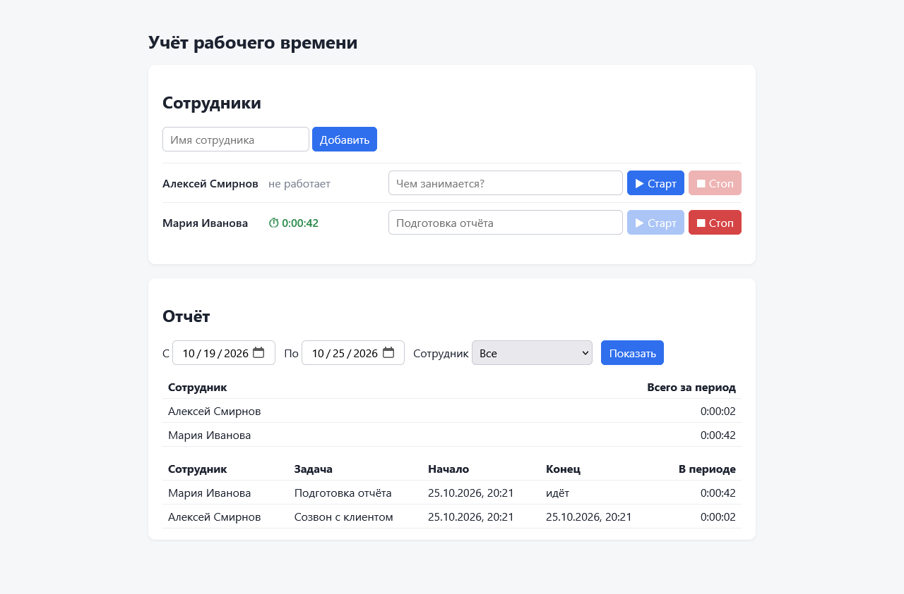

# Учёт рабочего времени

Небольшое веб-приложение для учёта рабочего времени сотрудников: добавить сотрудника, запустить и остановить таймер с описанием задачи, посмотреть записи и общее время каждого сотрудника за выбранный период. Данные хранятся в SQLite и не теряются после перезапуска.



## Запуск

Нужен Python 3.11+ и [uv](https://docs.astral.sh/uv/).

```bash
uv sync
uv run uvicorn app.main:create_app --factory --port 8000
```

Открыть http://127.0.0.1:8000. База создаётся в `data/tracker.db`, путь можно поменять переменной окружения `TRACKER_DB`.

Тесты:

```bash
uv run pytest
```

## Как устроено

| Файл | Что внутри |
|---|---|
| `app/db.py` | Схема SQLite и подключение |
| `app/tracker.py` | Логика: сотрудники, таймер, отчёт за период |
| `app/main.py` | HTTP API на FastAPI и раздача интерфейса |
| `app/static/` | Интерфейс: HTML, CSS и JavaScript без фреймворков и сборки |
| `tests/test_api.py` | 21 тест через HTTP API |

API:

| Метод | Путь | Что делает |
|---|---|---|
| GET | `/api/employees` | Список сотрудников и их запущенные таймеры |
| POST | `/api/employees` | Добавить сотрудника `{"name": "..."}` |
| POST | `/api/employees/{id}/start` | Запустить таймер `{"task": "..."}` |
| POST | `/api/employees/{id}/stop` | Остановить таймер |
| GET | `/api/report?start=&end=&employee_id=` | Записи и итоги за период `[start, end)`, время в ISO-8601 с часовым поясом |

Решения, которые стоит пояснить:

- **Один запущенный таймер на сотрудника.** Повторный «Старт» возвращает 409 и называет уже идущую задачу. Это проверяется в коде, а ещё гарантируется частичным уникальным индексом в базе (`WHERE stopped_at IS NULL`), поэтому два одновременных запроса тоже не создадут вторую запись.
- **Время хранится в UTC.** Интерфейс переводит выбранные даты из часового пояса браузера в UTC, сервер принимает только время с указанным поясом.
- **Отчёт обрезает записи по границам периода.** Задача с 23:00 до 02:00 даст 1 час в первый день и 2 часа во второй. Незавершённый таймер считается до текущего момента.
- **Таймер переживает перезапуск.** Запущенный таймер хранится в базе как запись без времени окончания, поэтому после перезапуска сервера он продолжает идти.
- **Время в тестах управляемое.** В приложение передаются «часы», и тесты двигают время вперёд без `sleep`, поэтому длительности проверяются точно до секунды.

## ИИ-инструменты

Код, тесты и этот README написаны в **Claude Code** (агент Anthropic для разработки в терминале) с моделью **Claude Opus 5.5**. Задачу я ставил агенту текстом и голосом через Telegram-бота, подключённого к сессии Claude Code. Агент сам писал код, запускал тесты и проверял интерфейс в браузере через Playwright. Я проверял результат и принимал решения.

Примеры запросов:

1. Текст тестового задания целиком плюс ограничения: «Python, FastAPI + SQLite, простой интерфейс без фреймворков, тесты на pytest, данные только вымышленные».
2. «Сделай тесты на основные сценарии через HTTP API, обязательно повторный запуск таймера, пустой отчёт и сохранение данных после перезапуска. Время в тестах подменяй, без sleep».
3. «Подними сервер и пройди интерфейс в браузере: два сотрудника, дубль имени в другом регистре, старт/стоп, отчёт, перезапуск сервера, отчёт за пустой период. Сделай скриншот».

## Найденные и исправленные ошибки

1. **Дубли имён на кириллице не отлавливались.** Сначала уникальность имени задавалась как `UNIQUE COLLATE NOCASE`. Тест `test_duplicate_name_rejected_case_insensitive` упал: «Мария» и «мария» сохранились как два разных сотрудника. Причина в том, что `NOCASE` в SQLite приводит к одному регистру только латиницу. Исправление: отдельная колонка `name_key` со значением `name.casefold()` (и схлопнутыми пробелами), уникальность проверяется по ней.
2. **База создавалась при импорте модуля.** В первой версии `app/main.py` в конце стояло `app = create_app()`. Из-за этого любой `import app.main`, в том числе в тестах, создавал файл `data/tracker.db` рядом с кодом. Заменил на фабрику: сервер запускается с `--factory`, а тесты создают приложение на временной базе.
3. **Предупреждение об устаревшем HTTP-клиенте в тестах.** Starlette 1.x предупреждает, что `TestClient` на `httpx` устарел. Зависимость заменена на `httpx2`, и тесты проходят без предупреждений.
4. **Вёрстка, найденная на скриншоте.** Заголовок колонки с числами был выровнен влево, а сами числа вправо. Статус «не работает» был зелёным, как у активного таймера. Поправил выравнивание (`th.num`) и сделал неактивный статус серым.

## Тесты

`tests/test_api.py` проверяет:

- добавление сотрудников, пустое имя, дубль имени без учёта регистра (в том числе на кириллице);
- старт и стоп таймера с точной длительностью;
- **повторный запуск таймера**: второй «Старт» при идущем таймере отклоняется, исходная задача не меняется; после остановки можно запустить снова, создаётся новая запись;
- стоп без запущенного таймера, пустое описание задачи, несуществующий сотрудник, независимые таймеры разных сотрудников;
- **пустой отчёт**: без сотрудников, с сотрудниками без записей (у каждого 0), за период без записей;
- обрезку записи, пересекающей границу периода; незавершённый таймер в отчёте; фильтр по сотруднику; некорректный период и время без часового пояса;
- **сохранение после перезапуска**: новое приложение на том же файле базы видит сотрудников, записи и запущенный таймер;
- раздачу интерфейса.

В проекте только вымышленные данные.
